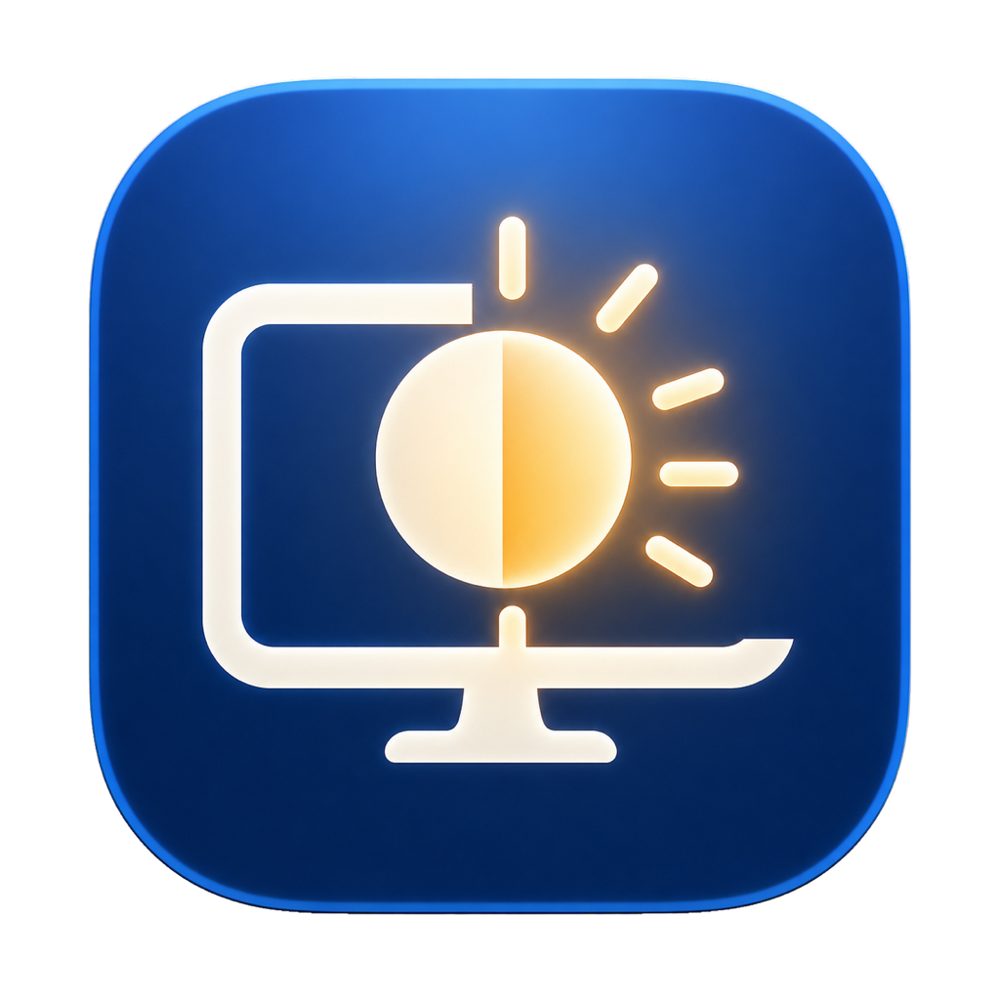

<p align="center">
  
</p>

<h1 align="center">BetterBrightness</h1>

<p align="center">
  A native macOS menu bar app that maps BetterDisplay brightness changes to WiZ smart lights on your local network.
</p>

<p align="center">
  <a href="https://github.com/andres-verdenelli/BetterBrightness/actions/workflows/build.yml"></a>
  <a href="LICENSE"></a>
</p>

## Overview

BetterBrightness keeps compatible WiZ lights visually aligned with a selected monitor. It listens for local brightness notifications from BetterDisplay, maps the monitor range to a configurable range for each light, and sends WiZ commands directly over UDP.

The app is intentionally small and native. The menu bar panel contains Pause or Resume, Discover Lights, its progress and latest results, Settings, and Quit. The panel stays open during discovery. Settings uses a light list and a dedicated brightness-mapping editor, with monitor and discovery options under Advanced Settings.

## Features

- Native SwiftUI menu bar app for macOS
- BetterDisplay brightness notification listener
- Automatic and manual WiZ discovery over the local network
- Stable light identity based on MAC address, with automatic DHCP address updates
- Safe reconciliation when a responding light reuses an address held by an unavailable device
- Per-light enable switch and custom name
- Configurable monitor and light brightness ranges
- User-facing light percentages from 1% to 100%, abstracting WiZ protocol values
- Configurable discovery attempts and response windows
- Persistent settings stored locally with `UserDefaults`
- Pause that keeps monitoring brightness while suppressing light commands

## Requirements

- macOS 26.5 or later
- Xcode 26 or later to build from source
- [BetterDisplay](https://github.com/waydabber/BetterDisplay) configured to emit brightness notifications
- One or more WiZ lights on the same local network as the Mac

## Build from source

1. Clone the repository:

   ```bash
   git clone https://github.com/andres-verdenelli/BetterBrightness.git
   cd BetterBrightness
   ```

2. Open `BetterBrightness.xcodeproj` in Xcode.
3. Select the `BetterBrightness` scheme and the `My Mac` destination.
4. Build and run the app.

You can also build from Terminal:

```bash
xcodebuild \
  -project BetterBrightness.xcodeproj \
  -scheme BetterBrightness \
  -configuration Release \
  CODE_SIGNING_ALLOWED=NO \
  build
```

For regular local installation, create a signed build in Xcode and move `BetterBrightness.app` to `/Applications`.

## First-time setup

1. Launch BetterBrightness from the menu bar.
2. Open **Settings**.
3. Open **Advanced Settings** with the gear button and confirm the BetterDisplay display ID for the monitor you want to follow.
4. Select **Discover Lights** from the menu bar while the Mac and lights are on the same network. Its results show the lights found and IP addresses updated.
5. Select each discovered light in Settings and enable **Sync brightness** for each light you want to control. Double-click its name in the sidebar, or right-click and choose **Rename**, to rename it. Right-click also provides **Remove Light**.
6. Drag the two handles on the Monitor or Light slider to choose its range. The minimum and maximum percentages appear at the left and right; changes save when you finish dragging. Hover over or click **?** for an explanation. The gear button opens Advanced Settings, including the BetterDisplay display ID.

Newly discovered lights remain disabled until you explicitly enable them.

## Brightness mapping

Each light has two ranges:

- **Monitor minimum and maximum** define the input range.
- **Light minimum and maximum** define the visible output range.

For example, a monitor range of 40%–80% mapped to a light range of 10%–90% produces 10% light brightness at the monitor minimum, 90% at the monitor maximum, and proportional values in between. Values outside the monitor range remain at the nearest light limit.

BetterBrightness presents light brightness as 1%–100%. The WiZ protocol conversion is handled internally.

## Discovery settings

- **Response window** controls how long the app listens after each discovery broadcast. The default is 500 ms; 500–1,000 ms is recommended.
- **Attempts** controls how many broadcasts are sent. The default is 3; 3–5 is usually sufficient, and the maximum is 10.

Longer windows and more attempts can improve discovery on slower networks, but also make each scan take longer.

## Privacy and networking

BetterBrightness operates locally:

- It does not require an account.
- It does not include analytics or telemetry.
- Settings stay on the Mac in `UserDefaults`.
- WiZ discovery uses UDP broadcast on port `38899`.
- Brightness commands are sent directly to enabled lights on the local network.

macOS will ask for Local Network access because discovery and control cannot work without it.

## Project structure

| File | Responsibility |
| --- | --- |
| `BetterBrightnessApp.swift` | App entry point, menu bar, and Settings scene |
| `BrightnessController.swift` | BetterDisplay listener, brightness mapping, and WiZ command delivery |
| `ConfigurationStore.swift` | Persistent settings, validation, and discovery reconciliation |
| `WiZDiscoveryService.swift` | UDP broadcast discovery and response parsing |
| `DiscoveryController.swift` | Shared discovery progress, results, and errors, independent of Settings |
| `SettingsView.swift` | Native settings interface and per-light controls |
| `LightDraft.swift` | Editable light settings that preserve unsaved manual IP changes during discovery |
| `BrightnessRangeControl.swift` | A shared range track with two native AppKit thumbs, keyboard and accessibility support |

See [ROADMAP.md](ROADMAP.md) for implementation notes and possible future improvements.

## Validation

The project is validated with a Release build using the full Xcode toolchain:

```bash
/Applications/Xcode.app/Contents/Developer/usr/bin/xcodebuild \
  -project BetterBrightness.xcodeproj \
  -scheme BetterBrightness \
  -configuration Release \
  -derivedDataPath /tmp/BetterBrightnessDerivedData \
  CODE_SIGNING_ALLOWED=NO \
  build
```

Network discovery and UDP delivery still require testing on real Wi-Fi hardware; compilation alone cannot verify device responses.

Run the discovery and range-control regression checks with `bash Tests/run.sh`. They use simulated discovery and a separate preferences domain; no real lights are controlled. See `Design/UI-REVIEW.md` for the selected design and validation evidence.

## Contributing

Bug reports, focused pull requests, and suggestions are welcome. Please describe the affected macOS version, BetterDisplay configuration, WiZ model, and the steps needed to reproduce the behavior.

## License

BetterBrightness is available under the [MIT License](LICENSE).

## Disclaimer

BetterBrightness is an independent project. It is not affiliated with or endorsed by BetterDisplay, WiZ, or Signify.
