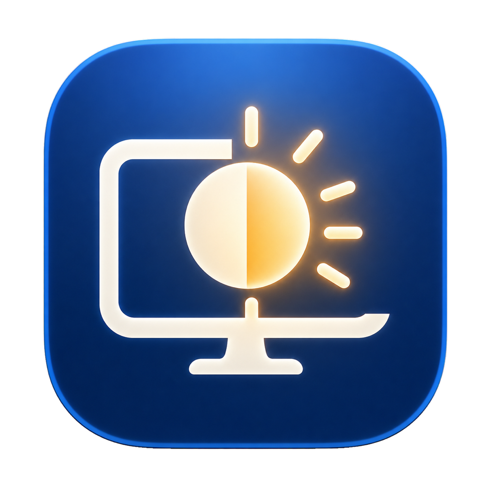

<p align="center">
  
</p>

<h1 align="center">BetterBrightness</h1>

<p align="center">
  A native macOS menu bar app that maps BetterDisplay brightness changes to WiZ smart lights on your local network.
</p>

<p align="center">
  <a href="https://github.com/andres-verdenelli/BetterBrightness/actions/workflows/build.yml"></a>
  <a href="LICENSE"></a>
</p>

## Overview

BetterBrightness keeps compatible WiZ lights visually aligned with a selected monitor. It listens for local brightness notifications from BetterDisplay, maps the monitor range to a configurable range for each light, and sends WiZ commands directly over UDP.

The app is intentionally small and native. The menu bar panel contains Pause or Resume, Discover Lights, its progress and latest results, Settings, and Quit. The panel stays open during discovery. Settings uses a light list and a dedicated brightness-mapping editor, with monitor and discovery options under Advanced Settings.

## Features

- Native SwiftUI menu bar app for macOS
- BetterDisplay brightness notification listener
- Automatic WiZ discovery at launch and on-demand broadcast discovery over the local network
- Stable light identity based on MAC address, with automatic DHCP address updates
- Safe reconciliation when a responding light reuses an address held by an unavailable device
- Per-light enable switch and custom name
- Configurable monitor and light brightness ranges
- User-facing light percentages from 1% to 100%, abstracting WiZ protocol values
- Configurable discovery attempts and response windows
- Persistent settings stored locally with `UserDefaults`
- Pause that keeps monitoring brightness while suppressing light commands
- Optional Launch at Login, controlled from Settings through macOS

## Requirements

- macOS 26.5 or later
- Xcode 26 or later to build from source
- [BetterDisplay](https://github.com/waydabber/BetterDisplay) configured to emit brightness notifications
- One or more WiZ lights on the same local network as the Mac

## Build from source

1. Clone the repository:

   ```bash
   git clone https://github.com/andres-verdenelli/BetterBrightness.git
   cd BetterBrightness
   ```

2. Open `BetterBrightness.xcodeproj` in Xcode.
3. Select the `BetterBrightness` scheme and the `My Mac` destination.
4. Build and run the app.

You can also build from Terminal:

```bash
xcodebuild \
  -project BetterBrightness.xcodeproj \
  -scheme BetterBrightness \
  -configuration Release \
  CODE_SIGNING_ALLOWED=NO \
  build
```

For regular local installation, create a signed build in Xcode and move `BetterBrightness.app` to `/Applications`.

### Repository tooling

Reusable developer and local maintenance commands live in `scripts/` and are versioned with the project, even though they are not included in the installed app. Build products, caches, personal settings, and installation backups stay outside version control. Agent instructions in [`AGENTS.md`](AGENTS.md) point to the relevant maintenance procedures.

For UI review, run `bash scripts/preview-ui.sh`. It builds the current checkout as a signed Debug preview, restarts that preview, and opens Settings automatically. The preview uses a separate bundle identifier and preferences; it does not replace or quit `/Applications/BetterBrightness.app`. Build products and logs are kept in a temporary directory. The `--preview-settings` launch option is available only in Debug builds.

### Personal updates from GitHub

For a personal installation built with a local ad hoc signature, run this from your checkout:

```bash
bash scripts/update-local.sh
```

The script fetches `main` from this repository's `origin`, exports that exact commit into a temporary directory, runs its regression checks, and builds a Release app with Xcode. It leaves your current branch and working files untouched; uncommitted changes and changes on other branches are not installed. Xcode at `/Applications/Xcode.app` is selected for this command without changing your system's developer-tool selection. Use `DEVELOPER_DIR` to select another full Xcode installation.

Only after the build and signature checks pass does the script back up the installed app, quit it, replace `/Applications/BetterBrightness.app`, and open the new version. It preserves the installed app's sandbox mode and bundle identifier so it continues using the same preferences location. It does not change preferences or register login items. This is a manual update command, with no scheduled or background updater.

Previous apps are kept under `~/Library/Application Support/BetterBrightness/Backups/`, in a separate dated folder for each update. To go back, quit BetterBrightness and use Finder to copy the desired backup's `BetterBrightness.app` into `/Applications`, replacing the current app, then reopen it. Backups remain until you delete them.

To run the checks and produce an app without installing or opening it:

```bash
bash scripts/update-local.sh --build-only
```

This prints the resulting app's temporary path. Both modes record the source commit in the app's `Info.plist` as `BetterBrightnessGitCommit`; normal updates also print the installed commit. The script requires network access, a full Xcode installation, and permission to write to `/Applications`. It stops if an existing app uses a certificate-based signature, to avoid replacing it with a different signing identity.

## First-time setup

1. Launch BetterBrightness from the menu bar.
2. Open **Settings**.
3. Open **Advanced Settings** with the gear button and confirm the BetterDisplay display ID for the monitor you want to follow.
4. Select **Discover Lights** from the menu bar while the Mac and lights are on the same network. Its results show the lights found and IP addresses updated.
5. Select each discovered light in Settings and enable **Sync brightness** for each light you want to control. Edit **Name** in the selected light’s **Light** section, beside its IP and MAC addresses, to rename it. Press Return or leave the field to save; Escape cancels. Right-click in the sidebar provides **Remove Light**.
6. Drag the two handles on the Monitor or Light slider to choose its range. The minimum and maximum percentages appear at the left and right; changes save when you finish dragging. Hover over or click **?** for an explanation. The gear button opens Advanced Settings, including the BetterDisplay display ID.

Newly discovered lights remain disabled until you explicitly enable them. Lights are added only when they respond to a Discovery broadcast; manual entry by IP is not available. New discoveries receive numbered names (`Light 1`, `Light 2`, and so on) from a saved sequence. Existing names are preserved, and numbers are not reused after renaming or removal. A new installation starts with no lights. IP and MAC addresses in Settings are read-only and updated by Discovery.

## Launch at login

Open **Advanced Settings** with the gear button and turn on **Launch at Login** to open BetterBrightness automatically when you log in to your Mac, including after a restart. Turn it off there to stop future automatic launches; the current app stays open.

BetterBrightness uses Apple's `SMAppService.mainApp` API and only registers when you turn the option on. macOS owns the setting. If approval is required, the app shows a pending message and an **Open Login Items Settings…** button. Approve BetterBrightness there; the app refreshes its status when you return. Changes made directly in System Settings are also reflected when you reopen the panel or return to the app.

Use a signed build installed in `/Applications` for the real login test. Verify enabling, any macOS approval, login after signing out or restarting, and disabling. Automated tests use a simulated service and never modify this Mac's login items.

## Brightness mapping

Each light has two ranges:

- **Monitor minimum and maximum** define the input range.
- **Light minimum and maximum** define the visible output range.

For example, a monitor range of 40%–80% mapped to a light range of 10%–90% produces 10% light brightness at the monitor minimum, 90% at the monitor maximum, and proportional values in between. Values outside the monitor range remain at the nearest light limit.

BetterBrightness presents light brightness as 1%–100%. The WiZ protocol conversion is handled internally.

## Discovery settings

- **Response window** controls how long the app listens after each discovery broadcast. The default is 500 ms; 500–1,000 ms is recommended.
- **Attempts** controls how many broadcasts are sent. The default is 3; 3–5 is usually sufficient, and the maximum is 10.

Longer windows and more attempts can improve discovery on slower networks, but also make each scan take longer.

## Privacy and networking

BetterBrightness operates locally:

- It does not require an account.
- It does not include analytics or telemetry.
- Settings stay on the Mac in `UserDefaults`.
- WiZ discovery uses UDP broadcast on port `38899`.
- Brightness commands are sent directly to enabled lights on the local network.

macOS will ask for Local Network access because discovery and control cannot work without it.

## Project structure

| File | Responsibility |
| --- | --- |
| `BetterBrightnessApp.swift` | App entry point, menu bar, and Settings scene |
| `BrightnessController.swift` | BetterDisplay listener, brightness mapping, and WiZ command delivery |
| `ConfigurationStore.swift` | Persistent settings, validation, and discovery reconciliation |
| `WiZDiscoveryService.swift` | UDP broadcast discovery and response parsing |
| `DiscoveryController.swift` | Shared discovery progress, results, and errors, independent of Settings |
| `LaunchAtLoginController.swift` | macOS login item registration and current system status |
| `LaunchAtLoginControl.swift` | Shared login toggle, approval guidance, and errors |
| `SettingsView.swift` | Native settings interface and per-light controls |
| `LightDraft.swift` | Editable light settings that preserve name and brightness edits while merging discovered addresses |
| `BrightnessRangeControl.swift` | A shared range track with two native AppKit thumbs, keyboard and accessibility support |

See [ROADMAP.md](ROADMAP.md) for implementation notes and possible future improvements.

## Validation

The project is validated with a Release build using the full Xcode toolchain:

```bash
/Applications/Xcode.app/Contents/Developer/usr/bin/xcodebuild \
  -project BetterBrightness.xcodeproj \
  -scheme BetterBrightness \
  -configuration Release \
  -derivedDataPath /tmp/BetterBrightnessDerivedData \
  CODE_SIGNING_ALLOWED=NO \
  build
```

Network discovery and UDP delivery still require testing on real Wi-Fi hardware; compilation alone cannot verify device responses.

Run the discovery, range-control, and launch-at-login regression checks with `bash Tests/run.sh`. They use simulated discovery and login services and a separate preferences domain; no real lights are controlled or login items changed. See `Design/UI-REVIEW.md` for the selected design and validation evidence.

## Contributing

Bug reports, focused pull requests, and suggestions are welcome. Please describe the affected macOS version, BetterDisplay configuration, WiZ model, and the steps needed to reproduce the behavior.

## License

BetterBrightness is available under the [MIT License](LICENSE).

## Disclaimer

BetterBrightness is an independent project. It is not affiliated with or endorsed by BetterDisplay, WiZ, or Signify.
